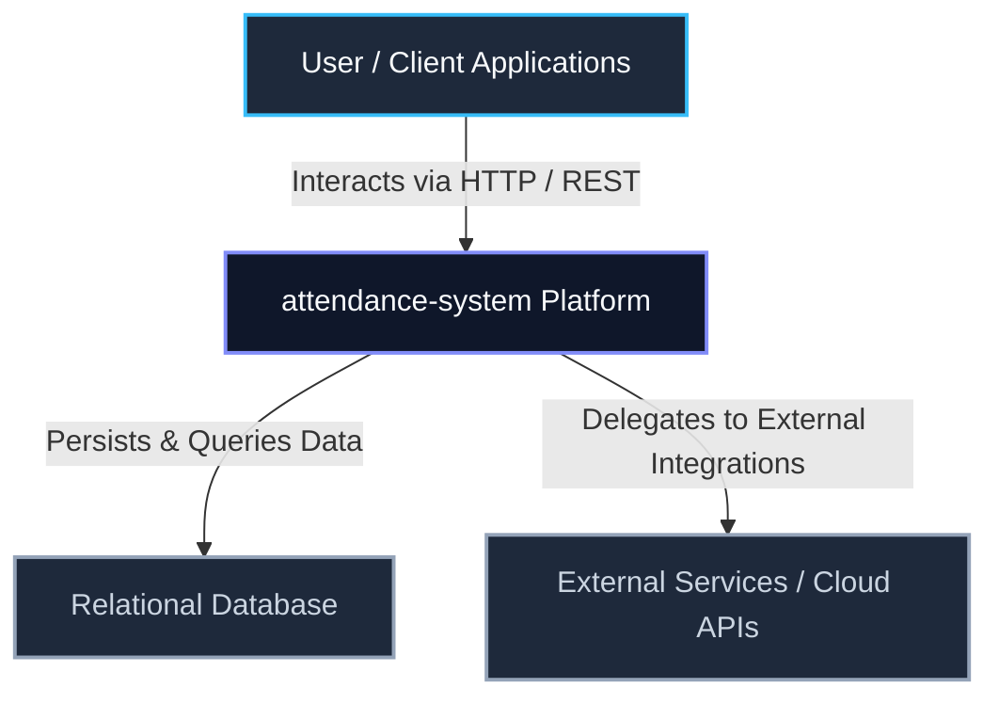
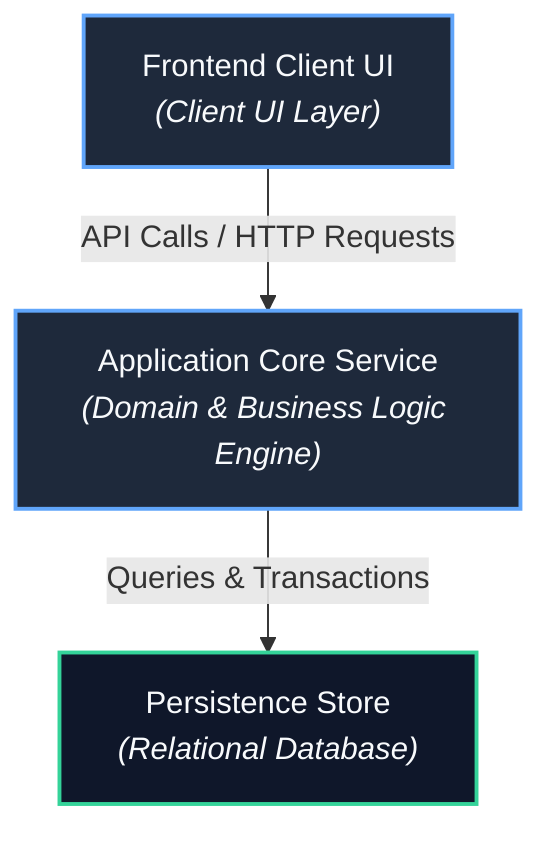
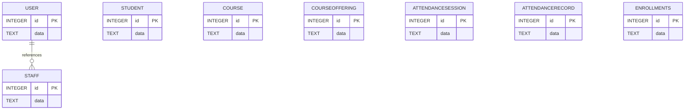
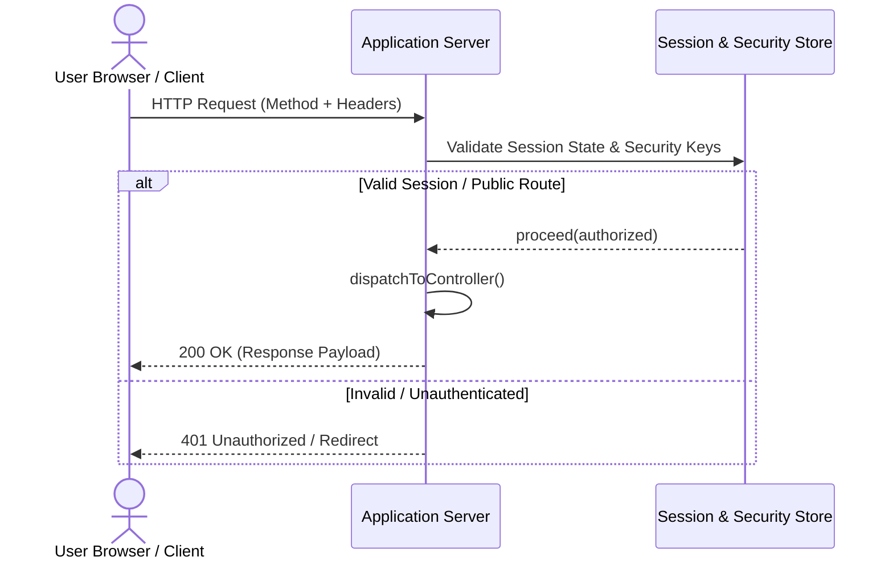

# attendance-system

> **Automated Technical Documentation & Continuous Synchronization**  
> *Synchronized by RepoMind AI & ASDSE Platform*

| Repository Version | Branch | Active Commit | Primary Language | Sync State |
| :--- | :--- | :--- | :--- | :--- |
| **V1** | `master` | [`5bc41a2`](https://github.com/PadmaPriya78/attendance-system.git/commit/5bc41a26a9c642fd37297daa7466ef7dc1b31057) | `Python` | `✓ Grounded & Synchronized` |

> **Commit Identity**: `5bc41a2` (5bc41a26a9c642fd37297daa7466ef7dc1b31057)  
> **Author**: Spidey390 | **Date**: 22/4/2026, 12:07:43 pm  
> **Message**: *Initial commit: Smart Attendance System*

---

## Table of Contents

- [Project Overview](#project-overview)
- [Key Features](#key-features)
- [Technology Stack](#technology-stack)
- [System Architecture](#system-architecture)
- [Repository Structure](#repository-structure)
- [Prerequisites](#prerequisites)
- [Installation & Setup](#installation--setup)
- [Environment Variables](#environment-variables)
- [Database Management](#database-management)
- [Running the Application](#running-the-application)
- [Build & Development Scripts](#build--development-scripts)
- [Authentication & Security](#authentication--security)
- [Dependencies](#dependencies)
- [License](#license)

---

## Project Overview

**attendance-system** is a software system built using **Python** with **Flask**, utilizing **PostgreSQL** for persistent storage.

This codebase provides a modular architecture designed for maintainability, with defined separation across business logic, routing, persistence, and service execution.

## Key Features

- **Modular Backend Service**: Engineered using Flask with structured request controllers and service boundaries.
- **Data Persistence Layer**: Grounded PostgreSQL storage managing 8 database entities with schema validation.
- **Authentication & Access Control**: Enforces security policies via Flask Session Management.

## Technology Stack

| Category | Technologies Verified in Codebase |
| :--- | :--- |
| **Primary Language** | `Python` (All: `Python`, `HTML`) |
| **Backend Framework** | `Flask` |
| **Database Engine** | `PostgreSQL` |
| **Authentication** | `Flask Session Management` |
| **Manifest Files** | `requirements.txt` |

## System Architecture

The repository follows a **Layered Architecture** pattern.

### System Context Diagram



### Container Architecture Diagram



## Repository Structure

| Directory / Path | Module Purpose |
| :--- | :--- |
| `.` | Application module directory |
| `smart-attendance-system-main` | Application module directory |
| `smart-attendance-system-main/app` | Application module directory |
| `smart-attendance-system-main/app/templates` | Application module directory |
| `smart-attendance-system-main/app/templates/admin` | Application module directory |
| `smart-attendance-system-main/app/templates/staff` | Application module directory |
| `smart-attendance-system-main/app/templates/student` | Application module directory |

## Prerequisites

Ensure the following tools, runtimes, and external services are configured on your host environment before setup:

### 💻 Runtime Environment & Package Managers

- **Python**: `3.10 or higher` (Core runtime environment)
- **Package Manager**: `pip`
- **Git**: `v2.30+` for source version control

### 🗄️ Database & Persistence Services

- **PostgreSQL**: 14+ — *Running PostgreSQL server instance or cloud database URL*

## Installation & Setup

Follow these step-by-step instructions to set up the repository locally for development:

### 1. Clone the Repository

```bash
git clone https://github.com/PadmaPriya78/attendance-system.git.git
cd attendance-system
```

### 2. Switch to Verified Branch / Commit

```bash
git checkout master
```

### 3. Configure Environment Variables

Initialize your local environment file:

```bash
# Create local .env file
touch .env
# Populate with the required variables documented in the Environment Variables section below
```

### 4. Install Dependencies

It is recommended to use a virtual environment:

```bash
# Create virtual environment
python -m venv venv

# Activate virtual environment
# On macOS/Linux:
source venv/bin/activate
# On Windows:
.\venv\Scripts\activate

# Install packages
pip install -r requirements.txt
```

## Environment Variables

Create a `.env` file in the root directory based on the configuration template below (placeholders are sanitized):

### Configuration Parameters Table

| Variable Name | Required | Default / Safe Placeholder | Description |
| :--- | :--- | :--- |
| `SECRET_KEY` | **Yes** | `your-secret-key` | Configuration parameter for SECRET_KEY |
| `DATABASE_URL` | Optional | `your-placeholder-value` | Configuration parameter for DATABASE_URL |
| `PORT` | Optional | `5000` | Application HTTP server listening port |

### Template Configuration File (`.env`)

```env
# Configuration parameter for SECRET_KEY (Required)
SECRET_KEY=your-secret-key

# Configuration parameter for DATABASE_URL (Optional)
DATABASE_URL=your-placeholder-value

# Application HTTP server listening port (Optional)
PORT=5000

```

## Database Management

* **Database Engine**: `PostgreSQL`
* **Registered Entities / Collections**: 8

### Database Initialization & Migration Strategy

Database connections are established dynamically via `PostgreSQL`. Ensure the database service is running prior to starting the application.

### Registered Entities & Data Models

| Entity / Table Name | Purpose | Key Attributes |
| :--- | :--- | :--- |
| `User` | Entity model for User | `id, created_at` |
| `Staff` | Entity model for Staff | `id, created_at` |
| `Student` | Entity model for Student | `id, created_at` |
| `Course` | Entity model for Course | `id, created_at` |
| `CourseOffering` | Entity model for CourseOffering | `id, created_at` |
| `AttendanceSession` | Entity model for AttendanceSession | `id, created_at` |
| `AttendanceRecord` | Entity model for AttendanceRecord | `id, created_at` |
| `enrollments` | Entity model for enrollments | `id, created_at` |

### Entity-Relationship Diagram



## Running the Application

### Development Mode

Start the application in active development mode:

```bash
flask run --port 5000
```

The service will be accessible at: `http://localhost:5000`

### Production Build & Execution

```bash
# 2. Start production server
gunicorn app:app -b 0.0.0.0:5000
```

## Build & Development Scripts

| Command | Script / Execution Target | Description |
| :--- | :--- | :--- |
| `flask run --port 5000` | `flask run --port 5000` | Starts the Python server process |
| `python -m unittest discover` | `python -m unittest discover` | Executes automated Python test cases |

## Authentication & Security

* **Authentication Mechanisms**: `Flask Session Management`
* **Token & Key Management**: Sensitive tokens must be stored in secure environment variables.

### Authentication Flow



## Dependencies

The system relies on **10** runtime and development dependencies defined in `requirements.txt`.

### Primary Packages

| Package | Version Range | Category |
| :--- | :--- | :--- |
| `Flask` | `latest` | `Runtime` |
| `Flask-SQLAlchemy` | `latest` | `Runtime` |
| `Flask-Login` | `latest` | `Runtime` |
| `Flask-WTF` | `latest` | `Runtime` |
| `Werkzeug` | `latest` | `Runtime` |
| `pandas` | `latest` | `Runtime` |
| `openpyxl` | `latest` | `Runtime` |
| `gunicorn` | `latest` | `Runtime` |
| `psycopg2-binary` | `latest` | `Runtime` |
| `xlsxwriter` | `latest` | `Runtime` |

## License

This project is licensed under the **Proprietary / Standard Repository License**.

---
*Generated automatically by [ASDSE RepoMind Intelligence](https://github.com/Spidey390/Neighbor-to-Neighbor) — Continuous Technical Documentation & GitHub Synchronization Pipeline.*
